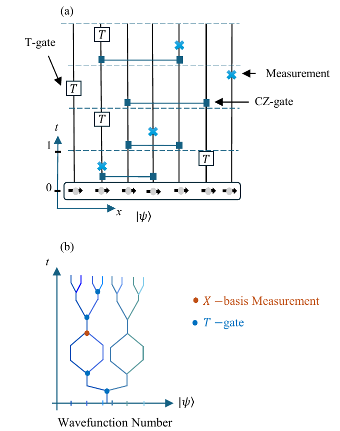
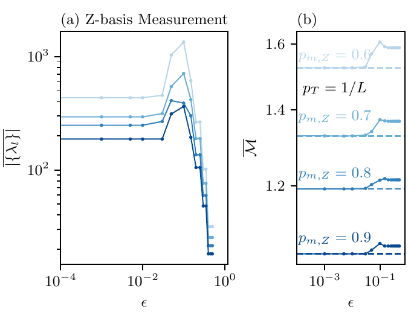
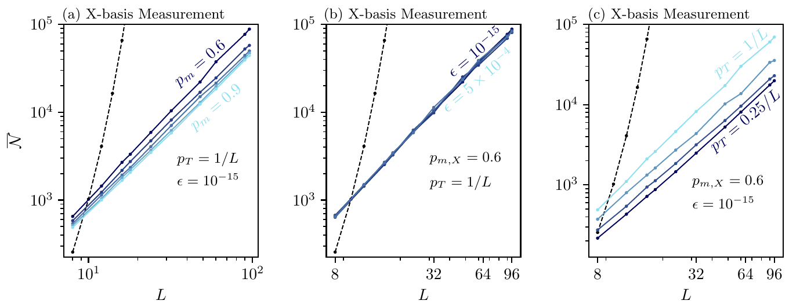
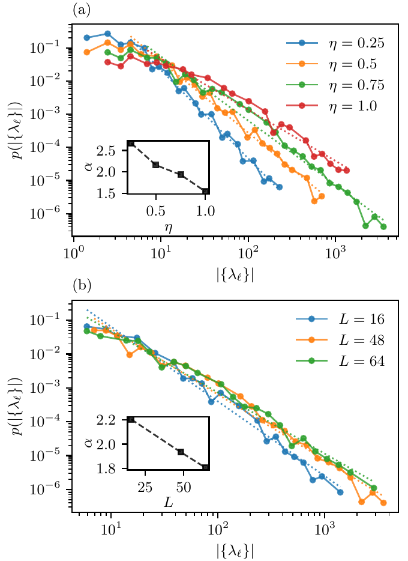
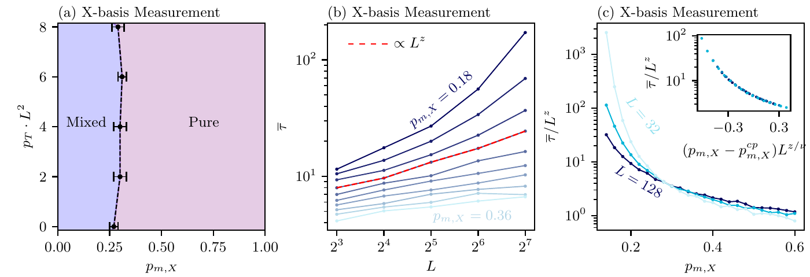
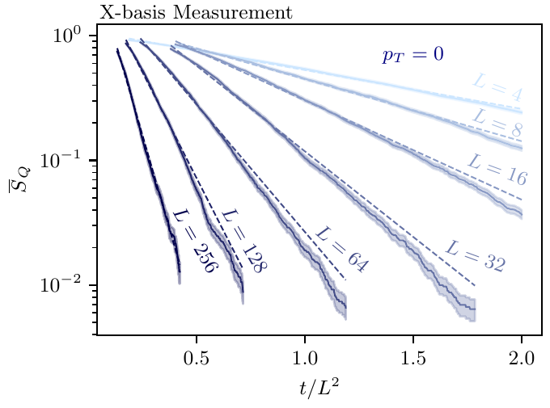
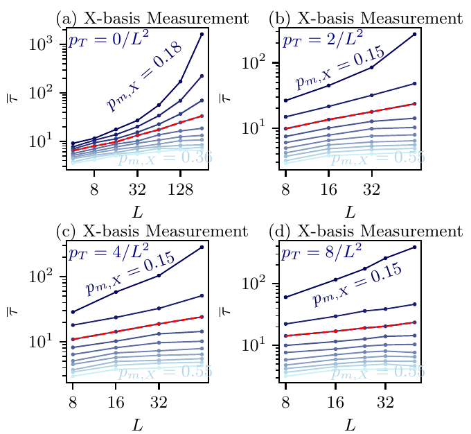
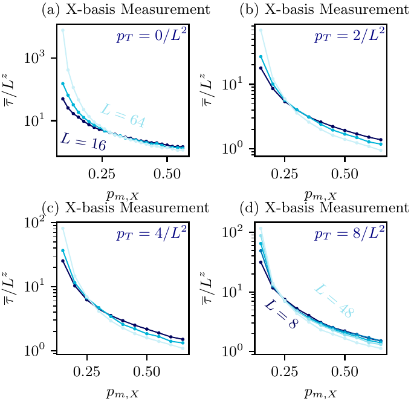
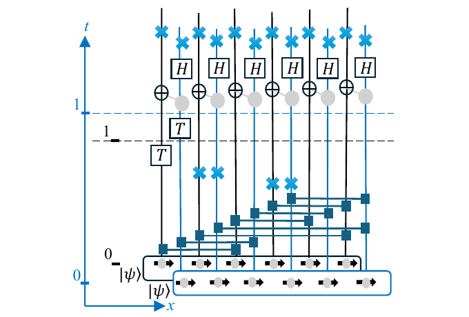
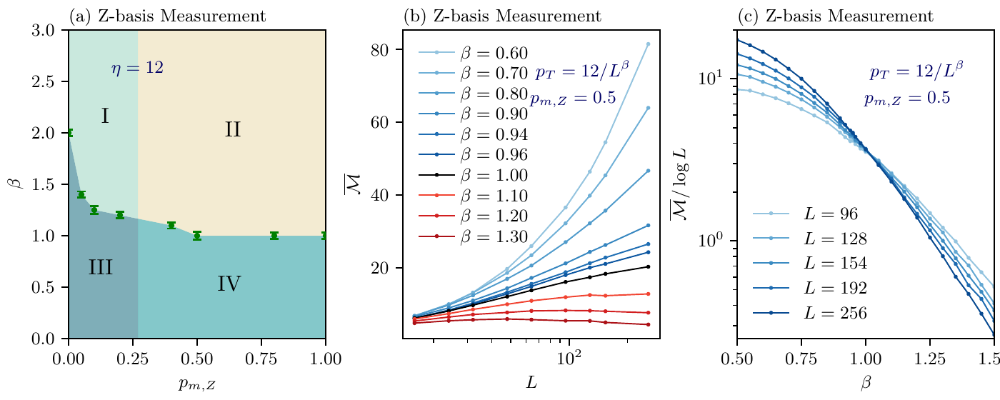

# Visual guide to the simulation drivers

These are **published figures**, not output generated by the example scripts. The code links identify the corresponding observable and circuit method. See the [figure-to-code map](../paper/FIGURE_MAP.md) for what can and cannot currently be reproduced. All images below retain the paper's [CC BY 4.0 license and attribution](../paper/figures/README.md).

## All-to-all circuit

Figure 2 defines the circuit model used by the [LRSD driver](fig34_lrsd.jl), [Bell-sampling driver](fig6_bell_magic.jl), and [dense ancilla reference](../src/PaperAllToAll.jl).

## LRSD truncation and cost

Figure 3(a) plots the cutoff-dependent logical-term count produced by [fig34_lrsd.jl](fig34_lrsd.jl) with `--basis Z`. Its panel (b), cutoff-dependent stabilizer nullity, **does not yet have an integrated implementation**; the Fig. 6 Bell samples are not a substitute.

Figure 4(a-c) uses the same [LRSD driver](fig34_lrsd.jl) with `--basis X` and separate measurement-rate, cutoff, and T-rate sweeps. The [plot helper](plot_examples.py) provides `fig4a`, `fig4b`, and `fig4c` views.

Figure 17 uses per-trajectory logical counts from the [LRSD driver](fig34_lrsd.jl); `plot_examples.py fig17` makes a basic histogram, not the published tail-fit analysis.

## Ancilla purification

Figure 5 and Appendix Figures 14-16 use the same ancilla-entropy protocol. [fig5_purification.jl](fig5_purification.jl) calls the [exact dense reference](../src/PaperAllToAll.jl), records the entropy trace, and scans Appendix B's exponential-fit windows. It is limited to small `L` and does not reproduce the paper's scalable LRSD or phase-boundary analysis.

## Bell sampling and magic

Figure 8 depicts the Bell-sampling method implemented in the original [nullity kernel](<../Stabilizer Nullity (Magic) Computation>) and exposed by [fig6_bell_magic.jl](fig6_bell_magic.jl).

Figure 6(b,c) uses this Bell driver for Z-basis stabilizer-nullity samples. The full Fig. 6(a) transition fit and entanglement boundary remain unimplemented.

